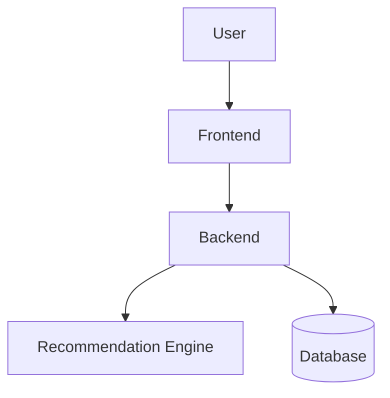

> Epic: #21 #22 #23
> Stories: #25 , #26 , #27 , #28, #29 , #30

# System Architecture Diagram

This document shows the high-level architecture of SonicScape. Figure 1 shows
the major components and how they connect: the user interacts with the
frontend, the frontend talks to the backend, and the backend uses the
recommendation engine and the database.

*Figure 1: High-level system architecture. It answers one question: what are
the major pieces of the system and how do they connect?*
