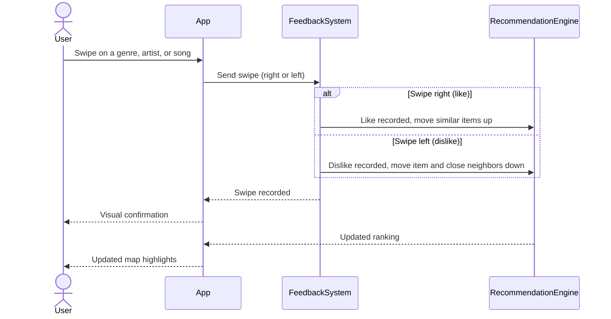

> Epic: #22
> Stories: #27 , #28

# Goal 2 Design

## Swipe Sequence Diagram

Figure 1 shows what happens when a user swipes on a genre, artist, or song.
The app sends the swipe to the feedback system, which records it. The app shows
the user a confirmation right away, and the recommendation engine then updates
the ranking and the map's highlights.

*Figure 1: Swipe sequence for Goal 2. It answers one question: what happens,
in order, between a user's swipe and the map updating?*
