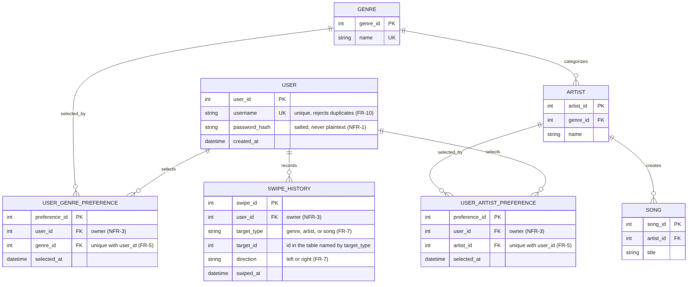
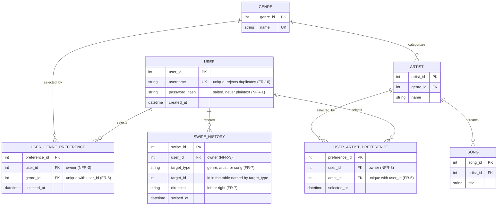

> Epic: #23 · Stories: #29, #30 · Task: #43
> Owner: hassanalrubai02 · Sprint: 2 · Status: draft
> Specification: [Goal 3 specification](../specs/specs_goal3.md)

# Goal 3 — Persistent user profile database

## 1. Purpose

This document proposes the local database design for SonicScape's persistent
user profiles. Goal 3 lets a user create an account, sign in, pick starting
genres and artists, and have those picks and their swipe feedback saved. When
the user signs in again, SonicScape restores that data so the personalized map
reflects earlier sessions (#29, #30).

The database technology and the final schema are **not decided**. Items that
need a team decision are collected in §7.

## 2. Entity-relationship diagram

Figure 1 shows which entities SonicScape stores, how they relate, and which
columns are primary keys (PK), foreign keys (FK), and unique keys (UK). The
editable source is [`goal3-er-diagram.mmd`](goal3-er-diagram.mmd) and the
exported image is [`goal3-er-diagram.png`](goal3-er-diagram.png).

*Figure 1 — Goal 3 ER diagram. It answers one question: what do we store,
and how does each user's saved data connect to the shared music catalogue?
One user has many preferences and swipes, and each belongs to exactly one
user. Attribute notes cite the requirement they satisfy, so a reviewer can
check the design against `specs_goal3.md`.*

## 3. Entities

| Entity | Kind | Responsibility |
|---|---|---|
| USER | per-user | Account identifier, unique username, salted password hash, creation time. |
| GENRE | shared catalogue | Genres shown as galaxies. |
| ARTIST | shared catalogue | Artists shown as star systems; each belongs to one genre. |
| SONG | shared catalogue | Songs shown as planets; each belongs to one artist. |
| USER_GENRE_PREFERENCE | per-user | One row per genre a user picked as a starting preference. |
| USER_ARTIST_PREFERENCE | per-user | One row per artist a user picked as a starting preference. |
| SWIPE_HISTORY | per-user | One row per swipe: who, on what, which direction, when. |

GENRE, ARTIST, and SONG are the same for every user. The three per-user
tables are what make the map personal (proposal §1.2, P3).

## 4. How saved data belongs to each user

- Every per-user row carries a `user_id` foreign key to USER. Nothing a user
  saves is stored without one.
- Starting preferences are link rows between a user and a catalogue item.
  USER_GENRE_PREFERENCE is the many-to-many link between users and genres,
  and USER_ARTIST_PREFERENCE is the same for artists.
- A swipe belongs to exactly one user. A user can have zero swipes, and a
  swipe never exists without its user.
- To restore a returning user, the application filters all three per-user
  tables by that user's `user_id`. Another user's rows are never read.
- Two users can pick the same genre or artist. They each get their own
  preference row pointing at the same catalogue row.

## 5. Constraints

- `USER.username` is unique.
- `UNIQUE (user_id, genre_id)` on USER_GENRE_PREFERENCE and
  `UNIQUE (user_id, artist_id)` on USER_ARTIST_PREFERENCE prevent duplicate
  starting picks.
- `SWIPE_HISTORY.direction` is restricted to `left` or `right`, and
  `target_type` to `genre`, `artist`, or `song`, with `CHECK` constraints.
- `SWIPE_HISTORY.target_id` points at GENRE, ARTIST, or SONG depending on
  `target_type`. One column cannot be a conventional foreign key to three
  tables, so the application must validate the target before saving (see §7).
- Passwords are stored only as salted hashes in `password_hash`. Modern
  hashing formats such as bcrypt and argon2 embed the salt in the hash string,
  so no separate salt column is needed.
- Foreign keys must be enforced by the database. In SQLite this needs
  `PRAGMA foreign_keys = ON` on each connection.

## 6. Persistence and restoration flows

### First-time user (#29)

1. The user creates an account, and SonicScape inserts a USER row.
2. The user signs in and picks starting genres and artists.
3. SonicScape inserts rows into USER_GENRE_PREFERENCE and
   USER_ARTIST_PREFERENCE.
4. The application uses those rows to seed the personalized map.

### Returning user (#30)

1. The user signs in and SonicScape identifies the account.
2. The application loads that user's genre preferences, artist preferences,
   and swipe history by `user_id`.
3. The map is rebuilt from the restored data instead of starting empty.
4. Each new swipe is inserted into SWIPE_HISTORY.

A user with no preferences or no swipes yet is valid. Each load simply
returns zero rows.

## 7. Key decisions and open questions

Per `CLAUDE.md`, data-model and dependency choices are decided by the team.
Nothing below is settled unless the Status column says so.

| Question | Proposed approach | Status |
|---|---|---|
| Local database technology | A local relational database. The prototype is Python, so SQLite is one candidate. | Team confirmation needed |
| Account identifier | Unique username | Team confirmation needed |
| Starting preferences | Separate genre and artist link tables | Proposed |
| Swipe history | Append-only: one row per swipe. This supports Goal 2 NFR-2, which requires every ranking change to trace to the swipe that caused it. | Proposed |
| Repeat swipes | Not defined: does swiping the same item twice add a row or replace the earlier one? | Open |
| Undo | Goal 2 asks "Can a user undo a swipe?" and has not answered. Undo would need a delete or status column. | Open (Goal 2) |
| Swipe targets | Store `target_type` + `target_id` because Goal 2 allows swiping on genres, artists, and songs. Alternative: three nullable foreign keys with a check that exactly one is set, which keeps real foreign keys. | Proposed; validation or alternative needed |
| Music relationships | One genre per artist, one artist per song. Many artists span genres, and a join table would be needed if that matters for the map. | Simplification; confirm |
| Password storage | Salted password hash | Required by the specification |

### Gaps to settle with Goals 1 and 2

The ER diagram does not yet cover the following, which other goals may need
from the same database:

- **Song link.** Goal 1 FR-5 opens a song on an external listening service and
  NFR-4 forbids live calls to external services, so SONG probably needs a
  stored link column.
- **Artist similarity.** Goal 1 FR-7 and NFR-3 need similarity data and must
  show which liked artist a highlight is similar to. This may need an
  ARTIST_SIMILARITY table, or similarity may be computed elsewhere.
- **Visited state.** Goal 1 FR-7 highlights artists the user has not "liked or
  visited", and Goal 1 lists what counts as "visited" as open. Persisting
  visits would need a table or column.
- **Derived preferences.** Proposal §3 says derived preferences are stored.
  This design stores only picks and swipes, so rankings would be recomputed
  from swipe history on sign-in. Confirm that or add a table.
- **Dataset source.** Goal 1 leaves open where the music dataset comes from
  and how large it is.

## 8. Traceability

Requirement IDs are from [`specs_goal3.md`](../specs/specs_goal3.md).

| Requirement | Design support |
|---|---|
| FR-1, FR-10 | USER with a unique `username` supports account creation and rejects duplicates. |
| FR-2 | USER supports sign-in and profile retrieval by `user_id`. |
| FR-3 | Application authentication logic, not the schema: the same rejection for an unknown username and a wrong password. |
| FR-4, FR-5 | USER_GENRE_PREFERENCE and USER_ARTIST_PREFERENCE store the first-time picks. |
| FR-6 | The saved picks seed the map. |
| FR-7 | SWIPE_HISTORY stores user, item, direction, and time. |
| FR-8 | Rows are loaded by `user_id` at sign-in. |
| FR-9 | Restored selections and swipes are the input to the map build. |
| NFR-1 | `password_hash` holds a salted hash. |
| NFR-2 | A persistent local database file survives restarts. |
| NFR-3 | Every per-user row carries a `user_id`, and reads and writes filter on it. |
| NFR-4 | Per-user tables may hold zero rows for a user. |

## 9. Verification checklist

- [ ] Team confirms the entities and relationships.
- [ ] Team confirms the local database technology.
- [x] Mermaid diagram renders in GitHub.
- [x] Source (`.mmd`) and exported image (`.png`) are in `docs/design/`.
- [ ] Figure is referenced from proposal §4 and listed in the document index.
- [ ] Design reviewed against #29 and #30.
