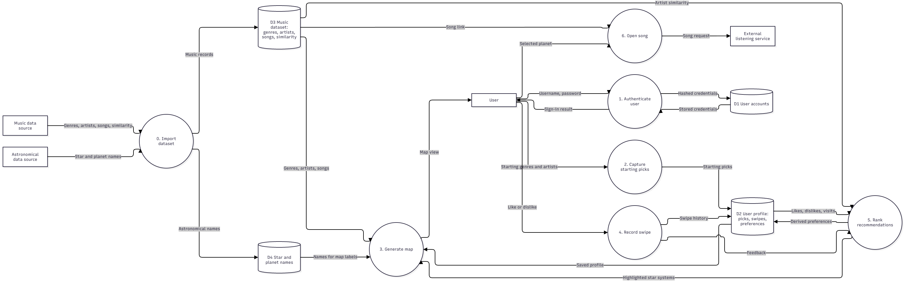
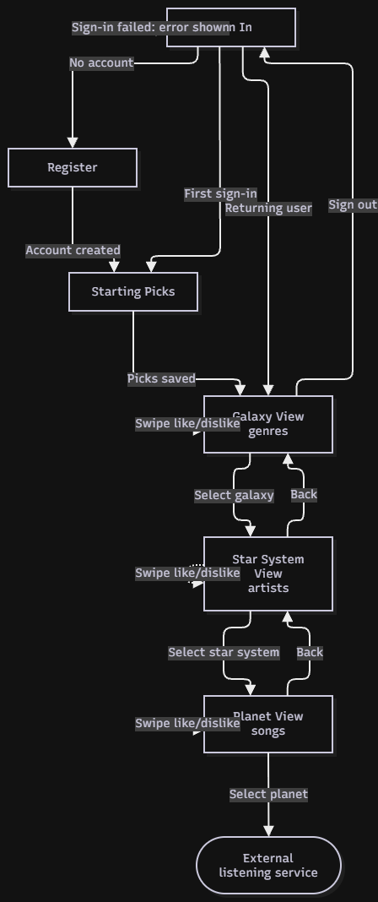
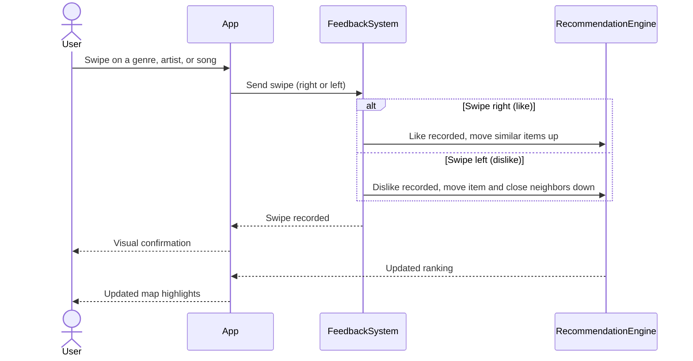
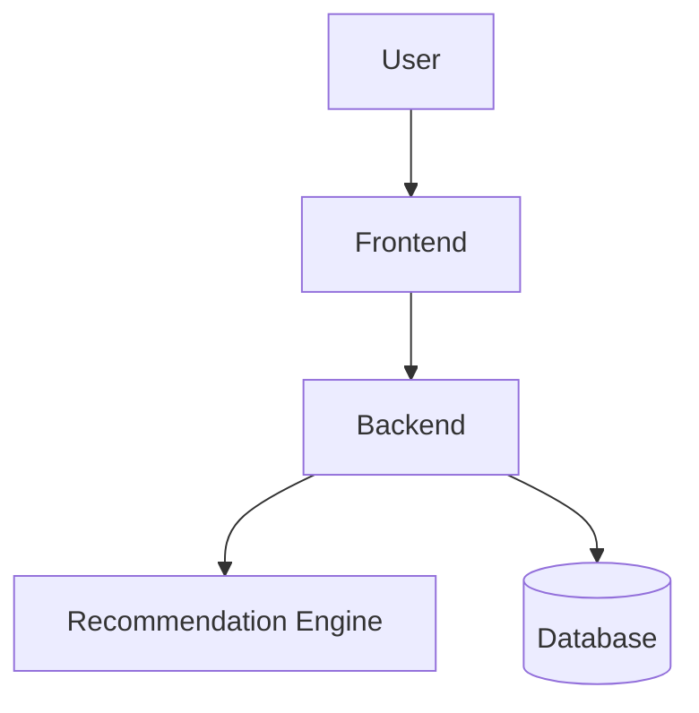
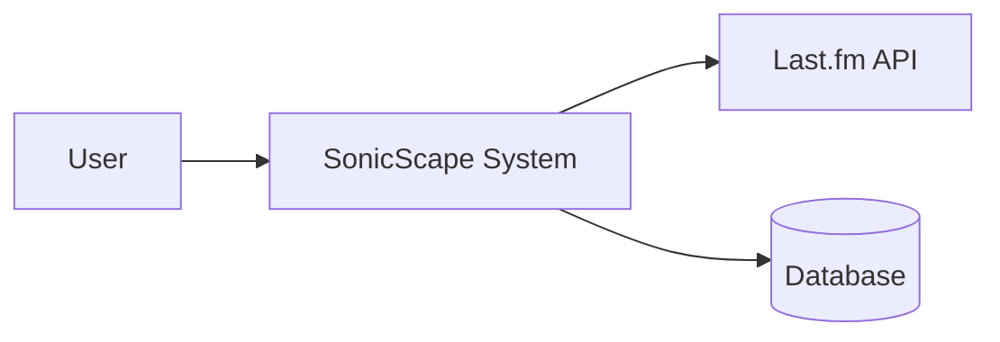
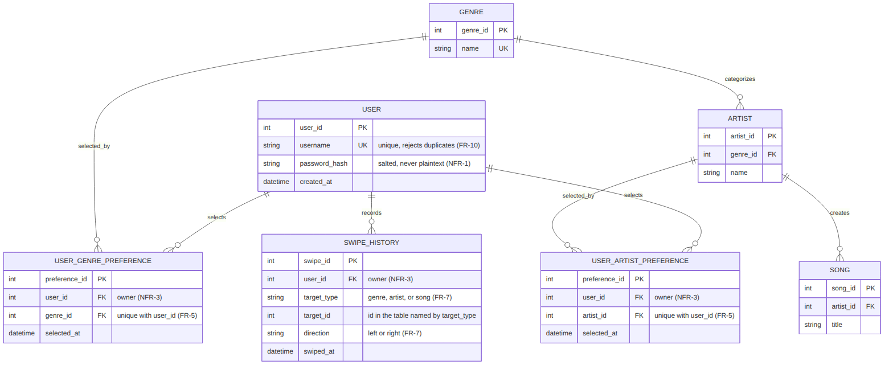

# Project Proposal — SonicScape

**Department of Computer Science**
**CPSC 490 Undergraduate Seminar in Computer Science — Proposal for Capstone Project**

**Group 17 — SonicScape** · Sponsor: Independent
Authors: Bhargava, Vibhor (vibhorbh), De Boer Bradley (braddeboer), Kaur Jaspreet (jaspreek9k), Alrubai Hassan (hassanalrubai02) 
Date: 2026-09-17

## 0. Abstract
Our goal as a team was to make a music app but after doing a little bit of market research, we found that most music apps have the same features i.e., liking songs, adding songs to playlists, searching up features and paying a premium to get no ads, the UI is plain and old and even regular app updates don't bring much changes so we felt the need to make the user experience more interesting by using planets and subsystems as our base idea. In our project, we want to build a new style of music app where the users will be able to listen to music in a new way that hasn't been explored much, as planets and star systems, you will be able to click into planets and star systems to switch genres and play around with playlists and songs instead of using those same old boring flat interfaces every other music app gives you. We want to give users the feeling that using the "premium" music apps shouldn't be industry standard that everyone has to use, we want music apps to become more experimental and playful even. 

For SonicScape, we want the app to feel more like exploring than just scrolling through another music platform. Instead of only giving users playlists or random recommendations, the app will let them move through different planets and star systems that represent genres, artists, and songs. As users like, dislike, or skip music, the app can slowly learn what they enjoy and use that to improve future recommendations. The main goal is to make discovering music feel more fun, personal, and interactive, while still keeping the basic features people expect from a music app.

## 1. Introduction
Our Team has decided to build Project SonicScape, we intend for this program to pull and parse information from Nasa's official website utilizing the free API keys that Nasa has to offer as well as potentially utilizing databases of music to organize a users preference on our own backend rather than relying fully on an llm. Once we are able to build the API parser and pull information we plan to utilize mapping of solar systems to create a music app that allows the user to traverse galaxies/star systems which will be interpreted as different music genres and artists. As the user begins traversing they will be able to swipe right or left on the given genre/artist/song to confirm or deny their fondness of the music. The current plan is to have Galaxies represent music Genres, Star Systems represent Artists, and individual planets representing songs from the Artists. We plan to incorporate some level of AI to begin creating a custom profile of the individual users music taste to help them find new music similar to what they already like. Our Project hopes to solve the problem of large corporations inbuilt AI models such as "DJ X" from Spotify. As a user of both Spotify and its DJ X for years now our team can personally attest to the lack luster nature of this AI DJ, often when you select the DJ they play music that you already are listening to, claim to get ready to play music that will quote "pump you up" just to play soft indie music, and just generally suggest poor music related to what you actually listen to.

### 1.1 Related Work
| Existing approach | What it does | Pros | Cons | Why ours differs |
|---|---|---|---|---|
| Spotify (incl. AL DJ) | Personalized playlists and an AI DJ that builds a running session from listening history; DJ accepts voice and text requests | Huge catalog, strong personalization, DJ can be steered by mood, genre, or artist | DJ is premium-only and frequently replays familiar tracks; discovery still runs through lists and search| SonicScape replaces lists with a galaxy users explore, and steers them toward nearby artists they haven’t heard yet rather than replaying favorites |
| Music Galaxy | 3D visualization of ~70k artists positioned by shared audience; can overlay your Spotify top artists | closest to our idea; genuinely immersive navigation | Visualization only; no feedback loop, no recommendations, no playback flow | SonicScape lets users swipe to like or dislike anything they find and plays music as they explore, so the map responds to them instead of just displaying data |
| YouTube Music | Recommends music using listening and Video-watch history | Very wide variety including covers, live versions and uploads | Recommendations loop back to the same artists; browsing is a standard list and menu layout | SonicScape turns browsing into exploring a galaxy and pushes users toward unfamiliar artists near what they already like |
|Every Noise at Once| 2D scatter-plot map of thousands of genres; click a genre to hear a sample, drill into a map of its artists | Shows how genres relate spatially; great for curiosity-driver exploring | Same map for every user; doesn’t learn your taste, a reference tool, not a listening app | SonicScape builds a map unique to each user from their starting picks and swipe history, and remembers it between sessions

### 1.2 Problem Statements

| Problem | Addressed by |
|---|---|
| P1 Users discover music mainly through lists, search, and AI sessions that tend to replay what they already listen to, so finding genuinely new music is hard. | Goal 1 |
| P2 Spatial music tools let users explore but give them no quick way to say what they like or don’t, so the experience can’t respond to them. | Goal 2 |
| P3 Existing music maps show the same view to everyone and don’t remember the user, so exploration never becomes personal. | Goal 3 |

## 2. Goals and Objectives

- **Goal 1: Galaxy Navigation with Discovery-Focused Recommendations** [[epic:#21]](https://github.com/vibhorbh/CPSC490-G17-SonicScape/issues/21)
  - Objective 1.1: Build a navigable music map where galaxies represent genres, star systems represent artists, and planets represent songs. Users can move between levels and play a song by selecting its planet. [[story:#25]](https://github.com/vibhorbh/CPSC490-G17-SonicScape/issues/25)
  - Objective 1.2: Highlight star systems close to artists the user likes but haven’t visited yet, so each session surfaces artists that are new to the user. [[story:#26]](https://github.com/vibhorbh/CPSC490-G17-SonicScape/issues/26)
- **Goal 2: Swipe Feedback ** [[epic:#22]](https://github.com/vibhorbh/CPSC490-G17-SonicScape/issues/22)
  - Objective 2.1: Let users swipe right or left on any genre, artist, or song to record a like or dislike. [[story:#27]](https://github.com/vibhorbh/CPSC490-G17-SonicScape/issues/27)
  - Objective 2.2: Use recorded feedback to update the map i.e., disliked items are de-emphasized, and neighbors of liked items are prioritized in recommendations. [[story:#28]](https://github.com/vibhorbh/CPSC490-G17-SonicScape/issues/28)
- **Goal 3: Personalized Map with a Persistent User Profile** [[epic:#23]](https://github.com/vibhorbh/CPSC490-G17-SonicScape/issues/23)
  - Objective 3.1: Let users create an account or sign in. On first login, they pick starting genres and artists that seed their map. [[story:#29]](https://github.com/vibhorbh/CPSC490-G17-SonicScape/issues/29)
  - Objective 3.2: Save each user’s profile, preferences, swipe history to a local database, and restore them on sign-in so the map reflects past sessions. [[story:#30]](https://github.com/vibhorbh/CPSC490-G17-SonicScape/issues/30)

## 3. Proposed Approaches

Our strategy is to replace list-based music discovery with a sequence of star systems that responds to the user’s direct feedback. The map is a three-level hierarchy: galaxies are genres, star systems are artists, and planets are songs. Each goal below states our approach, the alternatives we considered, and why we chose as we did. The implementation stack is detailed in §4.

Goal 1: Galaxy Navigation with Discovery-Focused Recommendations
- We will generate each user’s sequence of star systems from a stored dataset that the interface reads, rather than hardcoding one base map, so every user gets an individual experience of SonicScape. Astronomical data supplies the visual theme, such as star and planet names. Music data supplies what the each system means: artist similarity decides which star systems will be visited next. We rejected a purely decorative space theme because it would not solve the discovery problem (P1), and a free-form map showing many star systems at once because it leaves users with too many options and no clear unit to select or give feedback on. The genre → artist → song hierarchy gives users a clear path from genre, to an artists sytem, to a specific song. We rejected an unconstrained LLM-driven recommender as the core mechanism, because its output is hard to verify and tends to repeat familiar music, the weakness that motivated this project. As a stretch goal, an LLM may propose additional candidate genres, artists, and songs, but every candidate must exist in our music dataset and pass the same novelty and similarity ranking as any other, so the LLM widens the pool without choosing what the user sees.
- Selecting a planet opens the song on an external listening service, which works for any track in our data and needs no audio licensing. Two features are stretch goals: an LLM that proposes extra candidates, and short in-app preview clips. An LLM-proposed candidate must exist in our music dataset and pass the same novelty and similarity ranking as any other, so the LLM widens the pool without choosing what the user sees. In-app clips depend on third-party terms we do not control, and our focus is discovery, not playback.

Goal 2: Swipe Feedback
- Users record a like or dislike by swiping left or right on any genre, artist, or song. We chose explicit swipes because they are fast, familiar, and unambiguous. We rejected inferring taste from skips, because a skip can mean dislike, bad timing, or a song already heard, and star ratings, because they are precise but slow enough to interrupt exploration. Each swipe updates the same similarity ranking: items similar to liked ones move up, and disliked items and their close neighbors move down. We rejected collaborative filtering for this step because it needs a large user base we will not have. This addresses P2, because what the user sees next responds directly to their feedback.

Goal 3: Personalized Map with a Persistent User Profile
- On first sign-in, users pick starting genres and artists that seed what they are shown first. Their picks, swipe history, and derived preferences are stored locally and restored at each sign-in, so recommendations continue from past sessions. We rejected stateless sessions, because persistence is what makes the experience personal, and its absence is the gap in tools that show every user the same view (P3). We chose local storage over a hosted service because it keeps setup simple for a single-user application and avoids the cost of running a server.

## 4. Required Environment, Resources, and Planned Activities
### Environment and Resources
| Choice | Selected | Reason (tied to §3) |
|---|---|---|
| Language | Python 3.10+ | One language for the interface, data handling, and ranking logic keeps the team in a single toolchain. |
| Interface | Arcade (2D) | Shows one star system at a time with clickable planets and swipe input (Goals 1 and 2) without a separate web front end. |
| Database | SQLite | Local, serverless storage for accounts, preferences, and swipe history (Goal 3). |
| Music data | Last.fm API | Provides artist similarity and tags, which drive the ranking that decides the next star system (Goal 1). |
| Astronomical data | NASA open APIs | Supplies star and planet names for the visual theme only (Goal 1). |
| Song playback | External link-out (Spotify, YouTube); in-app clips are a stretch goal | Last.fm has no audio; link-out works for any track without licensing (Goal 1). |
| API keys | `.env` file, with `.env.example` committed | Keeps secrets out of the repository. |
| Dev tools | pytest, GitHub Actions, Mermaid | Tests for ranking and storage logic; diagrams kept as editable source. |
| Optional | LLM service (stretch goal, undecided) | Proposes extra candidates validated against the dataset (Goal 1). |

### Data Flow Diagram
 
*Figure 1 — Data Flow diagram. [View editable Mermaid source](../docs/design/dataflow.md).*

Figure 1 shows how data moves through SonicScape, from the outside sources it relies on to the local stores where it is kept, and covers all three goals (Epics #21, #22, and #23). Before anyone uses the app, a one-time import (process 0) pulls genres, artists, songs, and artist similarity from a music data source into the music dataset (D3), along with star and planet names from an astronomical data source into D4, so the map never depends on an outside service while a user is exploring. When a user registers or signs in, process 1 checks their credentials against the user accounts store (D1), where passwords are kept only as salted hashes, and on first sign-in process 2 saves the genres and artists they pick to their profile (D2), as described in Story #29. Process 3 then builds the user's personal map (Story #25) by combining the music dataset, the astronomical names used as labels, their saved profile, and the star systems highlighted by process 5. Each time the user swipes, process 4 records the like or dislike in D2 (Story #27) and passes it to process 5, which combines the user's likes, dislikes, and visits with artist similarity to decide which unvisited star systems to highlight (Stories #26 and #28), saving these derived preferences back to D2 so the map updates in the same session. Finally, when the user selects a planet, process 6 looks up the song's link in D3 and opens it on an external listening service, since SonicScape does not play or store audio itself. Because the user's picks, swipes, and preferences are saved locally and restored at each sign-in (Story #30), and every recommendation flows through process 5, each highlight can be traced back to the specific likes and similarity scores that produced it.

### Goal 1 Screen Flow

*Figure 2 — Goal 1 Screen Flow diagram. [View editable Mermaid source](../docs/design/screenflow.md).*

Figure 2 shows how a user moves between SonicScape's screens, centered on galaxy navigation and discovery (Epic #21). Every session begins at the Sign In screen, where a new user can go to Register, a first-time user is taken to Starting Picks to choose the genres and artists that seed their map, and a returning user goes straight to the Galaxy View. A failed sign-in keeps the user on the Sign In screen with an error message. From the Galaxy View, which shows genres, the user selects a galaxy to open the Star System View of that genre's artists, then selects a star system to open the Planet View of that artist's songs, and finally selects a planet to open the song on an external listening service (Story #25). Each map level has a back path to the level above it, so the hierarchy works as a clear path from broad exploration to a specific song rather than a maze. As the user explores, star systems similar to artists they have liked but not yet visited are highlighted on the map (Story #26), and the dashed loops on all three map screens show that swiping to like or dislike updates those highlights without leaving the current view. Signing out from any map screen returns the user to the Sign In screen.

### Goal 2 Swipe Sequence Diagram

*Figure : Swipe sequence for Goal 2. It answers one question: what happens,
in order, between a user's swipe and the map updating?*

This Sequence Diagram shows what will occur, in order, from the moment a user swipes on an item to the moment our application responds. It has four participants, drawn left to right as vertical lifelines, with time running from top to bottom. The User is the person using SonicScape and is drawn as a stick figure. The App is the part of the program the user sees and touches, which in the prototype is the Arcade interface. The FeedbackSystem is the logic that records a swipe as a like or a dislike. The RecommendationEngine is the logic that talks to last.fm and will generate new similar Artists, Genres, and Songs for the user based off of their likes and prefernces. The participants appear again at the bottom of the diagram, which is how the diagramming tool closes each lifeline and does not represent a second set of components.

The sequence begins when the User swipes on a genre, artist, or song, which is the first arrow, drawn as a solid line from the User to the App. This corresponds to Objective 2.1, which allows a swipe on any of the three kinds of item. The App then sends the swipe, together with its value (like or dislike), to the FeedbackSystem. From that point the diagram branches, shown by the dotted box labeled “alt”, which is the diagramming notation for alternatives of which exactly one happens. If the user swiped right, the FeedbackSystem records a like and tells the RecommendationEngine to move similar items up in the ranking. If the user swiped left, the FeedbackSystem records a dislike and tells the RecommendationEngine to move the item and its close neighbors down. These two branches correspond to the two halves of Objective 2.2, in which items similar to liked ones are prioritized and disliked items are deprioritized.

The remaining four arrows are dashed, which in a sequence diagram means a response or return message. First the FeedbackSystem returns “Swipe recorded” to the App, which confirms that the like or dislike was captured. The App then gives the User a “Visual confirmation”, so the person can see that the swipe registered. Separately, the RecommendationEngine returns the “Updated ranking” to the App, which carries the result of the re-ranking. Finally, the App shows the User the result of that new ranking. Together, the first two returns confirm that the feedback was received, and the last two show that the feedback changed what the user will see next, which is the claim behind problem statement P2, that the experience should respond to the user.

### Architectural Diagram

*Figure: High-level system architecture. It answers one question: what are
the major pieces of the system and how do they connect?*

This Architectural Diagram answers one question: what are the major pieces of Project SonicScape, and how are they connected? It has five boxes. The User is the person who runs the application and is the only element outside the system. The Frontend is the interface layer, which draws the screens, shows the star systems and planets, and detects clicks, drags, and swipes. The Backend sits between the interface and everything else. It receives what the user did, applies the application’s rules, and decides which other component to ask. Below the Backend are two components it uses directly. The Recommendation Engine, drawn as a rectangle, contains the similarity-based ranking that decides which star system comes next. The Database, drawn as a cylinder, which is the standard symbol for stored data, holds the persistent information described in Goal 3: user accounts, starting picks, and swipe history.

The arrows show the direction in which one component calls another. The User interacts with the Frontend, the Frontend passes requests to the Backend, and the Backend calls both the Recommendation Engine and the Database. The Frontend never talks to the Database or the Recommendation Engine directly, so all rules and storage go through one layer. The Recommendation Engine and the Database also do not talk to each other, which means the Backend is the only component that moves data between them. This separation is what lets the team work on the interface, the ranking, and the storage independently, and it matches the folder structure of the prototype, which has separate frontend, backend, recommender, and database folders.

### System Context Diagram

The system context diagram shows SonicScape as a single box and places it among the people and outside services it interacts with. Unlike the architectural diagram, we deliberately hide the internal components and ask only what is inside the system and what is outside it. The diagram has four elements. The User is the person who runs SonicScape, and is the only human actor. The SonicScape System is the application as a whole, covering the interface, the backend logic, and the recommendation ranking that the architecture diagram breaks apart. The Last.fm API is an external web service that supplies music data, specifically artists, tags, and artist-to-artist similarity. The Database, drawn as a cylinder, is the stored data for the application, which holds user accounts, starting picks, and swipe history (Goal 3).

The arrows show who initiates each interaction. The arrow from the User to the SonicScape System means the user acts on the system by signing in, choosing starting genres and artists, clicking through star systems and planets, and swiping to like or dislike. The arrow from the SonicScape System to the Last.fm API means the system sends requests out to Last.fm to retrieve similarity and artist data, and Last.fm’s responses come back along the same path. This is the dependency the similarity-based ranking in Goal 1 relies on, since SonicScape does not hold its own similarity data. The arrow from the SonicScape System to the Database means the system writes and reads persistent information, saving a swipe or account as it happens and restoring a user’s profile and history at sign-in (Objectives 3.1 and 3.2).

Reading the diagram as a whole, SonicScape has one kind of user and two things it depends on: a remote data service it does not control, and a local store that holds the user’s own data. The diagram also shows what the system does not do. There is no arrow to an audio service, because the application does not play music itself and will instead link-out, meaning everything the user hears happens outside of the application.

### Goal 3 Database Design

Figure 1 shows how SonicScape stores user accounts, music preferences, and swipe history. The database separates individual user information from the shared music catalogue.

*Figure 1 — Goal 3 ER diagram. [View editable Mermaid source](../docs/design/goal3-er-diagram.mmd).*

### Specification and design documents

| Document | Kind | Covers | Issues |
|---|---|---|---|
| [Goal 1 Specification](../docs/specs/specs_goal1.md) | specification | Goal 1 - Galaxy Navigation and Discovery Recommendations | #21, #25, #26, #47 |
| [Goal 1 Screen Flow](../docs/design/screenflow.md) | design | Goal 1 - Galaxy Navigation and Discovery Recommendations | #21, #25, #26, #46 |
| [Data Flow Diagram](../docs/design/dataflow.md) | Design | Goal 1 - Galaxy Navigation and Discovery Recommendations | #21, #25, #26, #53 |
| [Goal 2 Swipe Sequence Diagram](docs/design/goal2-design.md) and [Architectural Design](docs/design/architecture.md) | design | Goal 2 - Swipe feedback | #22, #27, #28 |
|[Goal 2 Specifications](docs/specs/specs_goal2.md)| Specs | Goal 2 :Swipe feedback | #22, #27, #28| 
| [Goal 3 Specification](../docs/specs/specs_goal3.md) | specification | Goal 3 — Persistent User Profile | #23, #29, #30, #42 |
| [Goal 3 Database Design](../docs/design/goal3-database.md) | design | Goal 3 — Persistent User Profile | #23, #29, #30, #43 |

**Goal 1 Specification** (`docs/specs/specs_goal1.md`, Epic #21, Stories #25 and #26). This specification, owned by Vibhor Bhargava and drafted in Sprint 2, defines the three-level music map at the center of SonicScape, in which galaxies represent genres, star systems represent artists, and planets represent songs. Under Story #25, its seven functional requirements cover generating each user's map from the stored dataset and that user's own data rather than a hardcoded base map, displaying galaxies labeled with genres, opening a galaxy to show its artists and a star system to show its songs, returning to the previous level with "back", and opening a selected song on an external listening service. Under Story #26, the map highlights star systems that are similar to artists the user has liked but has not yet liked or visited. Four non-functional requirements set limits on the experience: moving between levels takes under one second on the demo dataset, a song can be reached from a genre in three selections or fewer, every highlighted star system can be traced to the liked artist it is similar to, and navigation reads only from the local dataset without live calls to external music services. In-app audio playback is out of scope as a stretch goal, along with LLM-driven recommendations, a free-form map layout, and social features. The acceptance criteria require that a user can navigate to a song by clicking, that highlights can be traced to liked artists, that each requirement has a test, that at least four of five usability testers can find and open a requested song without help, and that users like highlighted artists more often than random ones. Open questions include which listening service a planet opens, where the music dataset and similarity data come from, what counts as "visited", how many star systems are highlighted, and which astronomical source supplies star and planet names.

**Goal 2 Specification** (`docs/specs/specs_goal2.md`, Epic #22, Stories #27 and #28). This specification, owned by Jaspreet Kaur and drafted in Sprint 2, defines swipe feedback, the way users tell SonicScape what they like and dislike while they explore the map. Users can swipe right or left on any genre, artist, or song, and each swipe updates the similarity ranking that decides which items the map highlights. The first three functional requirements, under Story #27, state that swiping right records a like, swiping left records a dislike, and every recorded swipe gives the user a visual confirmation. The remaining three, under Story #28, describe how that feedback changes recommendations: a like moves items similar to the liked item up the similarity ranking, a dislike moves the disliked item and its close neighbors down, and the map's highlights update in the same session, without the user signing out and back in. Two non-functional requirements support this. Highlights must update within one second of a swipe on the demo dataset, and every ranking change must be traceable to the swipe that caused it, which keeps the similarity approach inspectable and is the reason it was chosen over an LLM. Inferring taste from skips, star ratings, collaborative filtering, and LLM-driven recommendations are all out of scope. The acceptance criteria require that a user can like and dislike a genre, an artist, and a song by swiping through the interface, that a swipe visibly changes the map's highlights in the same session, that each requirement has a test, and that the repository checks and prototype tests pass. Open questions still to be decided include whether a dislike lowers an item or hides it entirely, what counts as a "close neighbor", whether a swipe on a genre affects the artists and songs inside it, and whether a swipe can be undone.

**Goal 3 Specification** (`docs/specs/specs_goal3.md`, Epic #23, Stories #29 and #30, Task #42). This specification, owned by hassanalrubai02 and drafted in Sprint 2, defines user accounts and the persistent profile that makes each user's map personal. Under Story #29, its functional requirements cover creating an account, rejecting a username that is already registered, signing in and loading the user's profile, rejecting invalid credentials without revealing whether the username or the password was wrong, letting first-time users choose starting genres and artists, saving those choices to their account, and using them to initialize the personalized map. Under Story #30, they cover saving each swipe's item, direction, and time to the user's swipe history, restoring a returning user's profile, starting selections, and swipe history at sign-in, and building their map from that restored data instead of resetting it. Four non-functional requirements require passwords to be stored as salted hashes, data to survive closing and restarting the application, each user's data to stay separate from other accounts, and a brand-new user with no selections or swipes to open a map without an error. Third-party sign-in, cloud synchronization, password recovery, email verification, editing or deleting accounts, social features, and sharing profiles are out of scope. The acceptance criteria require that swipes survive a restart, two accounts each see only their own data, an unknown username and a wrong password produce the same rejection message, and stored accounts show a salted hash rather than a plaintext password. Open questions include the database technology, usernames versus email addresses, the rules for valid credentials, how many starting picks are required, whether preferences can be changed later, how repeated swipes are stored, how signing out works, and what the map shows for a user with no saved data. The specification links to the Goal 3 database design (`docs/design/goal3-database.md`, Task #43).

**Goal 1 Screen Flow** (`docs/design/screen-flow.md`, Epic #21, Stories #25 and #26, Task #46). This diagram shows how a user moves between SonicScape's screens, from signing in to opening a song, and traces the navigation described in the Goal 1 specification. It contains six screens: Sign In, Register, Starting Picks, Galaxy View, Star System View, and Planet View, plus the external listening service, which is drawn with a rounded shape to mark it as outside the application. Every session begins at the Sign In screen. A user with no account goes to Register and, once the account is created, to Starting Picks, where they choose the genres and artists that seed their map. A first-time user who signs in is also sent to Starting Picks, while a returning user goes straight to the Galaxy View. A failed sign-in loops back to the Sign In screen with an error shown. From the Galaxy View, which shows genres, selecting a galaxy opens the Star System View of that genre's artists, and selecting a star system opens the Planet View of that artist's songs. Selecting a planet opens the song on the external listening service (Story #25). The Star System View and Planet View each have a back path to the level above, so the hierarchy works as a clear path from broad exploration to a specific song. Each arrow is labeled with the action that triggers it. On all three map screens, a "swipe like/dislike" arrow loops back to the same screen, because a swipe updates the highlighted star systems (Story #26) without leaving the current view. Signing out from the Galaxy View returns the user to the Sign In screen. Taken together, the diagram shows that a song can be reached from a genre in three selections (galaxy, star system, planet), matching the limit set in the Goal 1 specification.

**Data Flow Diagram** (`docs/design/data-flow.md`, Epics #21, #22, and #23, Stories #25–#30, Task #53). This Level 1 data flow diagram shows how data moves through SonicScape: where it comes from, what the system does with it, and where it is stored. It has four external entities (the user, a music data source, an astronomical data source, and an external listening service), seven processes drawn as circles, and four local data stores drawn as cylinders. Process 0 imports genres, artists, songs, and artist similarity from the music data source into the music dataset (D3), and star and planet names from the astronomical data source into D4, so the rest of the system reads music and naming data from local stores. When a user registers or signs in, process 1 checks their credentials against the user accounts store (D1), and on first sign-in process 2 saves their starting genres and artists to their profile (D2) (Story #29). Process 3 builds the personalized map (Story #25) by combining the music dataset, the astronomical names used as labels, the user's saved profile, and the star systems highlighted by process 5. Each swipe passes through process 4, which records the like or dislike in D2 (Story #27) and forwards it to process 5. Process 5 combines the user's likes, dislikes, and visits with artist similarity to rank which unvisited star systems to highlight (Stories #26 and #28), and saves the resulting preferences back to D2 so the map updates in the same session. When the user selects a planet, process 6 looks up the song's link in D3 and opens it on the external listening service. Every arrow is labeled with the data it carries. Because the profile is restored at each sign-in (Story #30) and every recommendation flows through process 5, each highlight can be traced back to the likes and similarity scores that produced it.

**Goal 2 Swipe Sequence Diagram** (Epic #22, Stories #27 and #28). This sequence diagram shows, step by step, what happens when a user swipes on a genre, artist, or song. It has four participants arranged left to right: the User, the App, the FeedbackSystem, and the RecommendationEngine. The exchange begins when the user swipes on a genre, artist, or song in the App, which sends the swipe, marked as right or left, to the FeedbackSystem. An "alt" block then shows the two possible paths. If the user swiped right, the FeedbackSystem records a like and tells the RecommendationEngine to move similar items up. If the user swiped left, it records a dislike and tells the RecommendationEngine to move the item and its close neighbors down. These two branches correspond to the like and dislike requirements in the Goal 2 specification (Story #27) and to the ranking changes that follow from them (Story #28). After the branch, the diagram shows four return messages, drawn as dashed arrows. The FeedbackSystem reports back to the App that the swipe was recorded, and the App immediately gives the user a visual confirmation. The RecommendationEngine then returns the updated ranking to the App, and the App shows the user the updated map highlights. The order of these messages separates the two outcomes of a swipe: the user is told that their swipe was recorded right away, and the change to the map's highlights follows once the RecommendationEngine has updated the ranking. Because every change in ranking starts from a recorded like or dislike in this sequence, the diagram also shows how each highlight change can be traced back to the swipe that caused it.

**System Architecture Diagram** (Epics #21, #22, and #23, Stories #25–#30). This diagram gives the high-level structure of SonicScape and answers one question: what are the major pieces of the system, and how do they connect? It shows five components arranged in layers. The user interacts with the frontend, the frontend communicates with the backend, and the backend relies on two components below it: the recommendation engine and the database, which is drawn as a cylinder to mark it as storage. Each arrow points from one layer to the layer it depends on, so the user never reaches the backend, recommendation engine, or database directly; every request passes through the frontend and then the backend. Because it covers all three epics and every story, the diagram serves as the overall map of the system that the more detailed design documents build on: the screen flow shows the frontend's screens, the swipe sequence diagram shows the recommendation engine responding to feedback, and the Goal 3 database design shows what the database stores.

**System Context Diagram** (Epic #22, Stories #27 and #28). This diagram shows SonicScape as a single box and places it in its surroundings, showing who uses the system and which outside components it depends on, without showing anything inside it. It has four elements. The user interacts with the SonicScape system, and the system in turn connects to two things outside it: the Last.fm API and a database, drawn as a cylinder to mark it as storage. All arrows point outward from the user, through SonicScape, to the Last.fm API and the database, showing that the user works only with SonicScape and never contacts these outside components directly. Among the design documents, this diagram is the only one that names a specific external music service, identifying the Last.fm API as an outside source the system connects to.

**Goal 3 Database Design** (Epic #23, Stories #29 and #30, Task #43). This entity-relationship diagram shows the proposed database structure for SonicScape's persistent user profiles, and how user accounts, starting genre and artist preferences, and swipe history relate to the shared music catalogue. It contains seven entities in two groups. The music catalogue is shared by all users: each GENRE has an ID and a unique name, each ARTIST has an ID, a name, and a foreign key to the genre that categorizes it, and each SONG has an ID, a title, and a foreign key to the artist that created it. The remaining four entities belong to individual accounts. USER stores an ID, a unique username that rejects duplicates (FR-10), a password hash that is salted and never stored as plaintext (NFR-1), and the date the account was created. USER_GENRE_PREFERENCE and USER_ARTIST_PREFERENCE record the starting genres and artists a user selects: each row links one user to one genre or artist with the time it was selected, and the pair of user and genre, or user and artist, is unique, so the same choice cannot be saved twice (FR-5). SWIPE_HISTORY records every swipe with the user who made it, the type of item swiped (genre, artist, or song), the item's ID in the table named by that type, the direction (left or right), and the time of the swipe (FR-7). Every user-owned table carries a user_id foreign key marking its owner, which keeps each user's preferences and swipes separate from other accounts (NFR-3). Primary keys identify records, foreign keys link related entities, and unique keys prevent duplicate values. Taken together, the diagram shows how the requirements of the Goal 3 specification are reflected in the database: account creation and duplicate checks in USER, starting selections in the two preference tables, and swipe history in SWIPE_HISTORY.

### Planned activities — the work items

| Issue | Type | Activity | Parent | Owner | Sprint |
|---|---|---|---|---|---|
| [#46](https://github.com/vibhorbh/CPSC490-G17-SonicScape/issues/46) | task | Create goal 1 screen flow diagram | #25, #26 | vibhorbh | Sprint 2 |
| [#47](https://github.com/vibhorbh/CPSC490-G17-SonicScape/issues/47) | task | Write goal 1 specifications in specs_goal1.md | #25, #26 | vibhorbh | Sprint 2 |
| [#53](https://github.com/vibhorbh/CPSC490-G17-SonicScape/issues/53) | task | Create goal 1 data flow diagram | #25, #26 | vibhorbh | Sprint 2 |
| [#42](https://github.com/vibhorbh/CPSC490-G17-SonicScape/issues/42) | task | Write Goal 3 specification | #29, #30 | hassanalrubai02 | Sprint 2 |
| [#43](https://github.com/vibhorbh/CPSC490-G17-SonicScape/issues/43) | task | Create Goal 3 database design and ER diagram | #29, #30 | hassanalrubai02 | Sprint 2 |
| [#72](https://github.com/vibhorbh/CPSC490-G17-SonicScape/issues/72) | task | Set up swipe functionality on the main screen | #27 | braddeboer | Sprint 3 |
| [#74](https://github.com/vibhorbh/CPSC490-G17-SonicScape/issues/74) | task | Write detailed explanations for tables and diagrams in proposal.md | #46, #43, #44 | bradeboer | Sprint 3 |

## 5. Project Outcomes

> Describe the outcomes or deliverables, e.g., final project report, user
> manuals, source code, data or database files, etc.
>
> Note: the deliverables always include the team GitHub repository, which
> must already contain prototype v0 (a thin end-to-end proof-of-concept,
> however small, running when this proposal is submitted). Briefly describe
> what your v0 demonstrates and how to run it.

〈**One or two paragraphs** explaining the project outcome overall — what will
exist when the project is finished, and what it will let someone do. Keep it
prose, not a checklist; name the deliverables inside the paragraphs, and say
briefly what prototype v0 demonstrates today and how to run it.〉

## 6. Project Timeline

> Identifies tasks (project objectives) to be performed, milestones to be
> met, and the estimated number of hours for each task.

〈**This is the plan for CPSC 491 next semester — the implementation timeline,
not this semester's proposal work.** Identify the tasks (your objectives from
§2), the milestones, and the estimated hours for each, in the order they will
be built. State the assumptions it rests on (sponsor availability, data
access, hardware).〉

| Task (objective) | Milestone | Owner | Est. hours | Spring phase |
|---|---|---|---|---|
| 〈…〉 | 〈…〉 | 〈…〉 | 〈…〉 | 〈…〉 |
| 〈…〉 | 〈…〉 | 〈…〉 | 〈…〉 | 〈…〉 |

〈Do **not** put this fall's four proposal sprints here — those live on the
project board and in `docs/sprint-reviews/`. This section answers "how does
the system actually get built next semester?"〉

## 7. AI Usage

> Per the course AI policy (see the syllabus, Use of AI Tools), disclose the
> AI tools used in preparing this proposal and the prototype: which tools,
> for what tasks (e.g., code generation, test writing, debugging,
> diagramming), and approximately what fraction of each artifact was
> AI-assisted.
>
> Reminder: the prose of this proposal must be your own writing. You remain
> fully responsible for the correctness of all AI-assisted work, including
> the prototype code.

〈Your disclosure. Naming the tool is not disclosure — name what it drafted,
what fraction of each artifact was AI-assisted, and how you verified it.〉

## 8. References

> [1] Burges, C. J. C. Tutorial on Support Vector Machines for Pattern
> Recognition. Kluwer Academic Publishers, 1998.
> [2] Chen, P., Fan, R., and Lin, C. A study on SMO-type decomposition
> methods for support vector machines. IEEE Transactions on Neural Networks,
> 2006.
> [3] For Wikipedia, specify the URL here
> [4] For a web source, specify the URL here plus date accessed

〈Number references in the order first cited and cite them in the text as
[1], [2]. Every entry must be a source a team member has actually read and
can produce on request.〉
